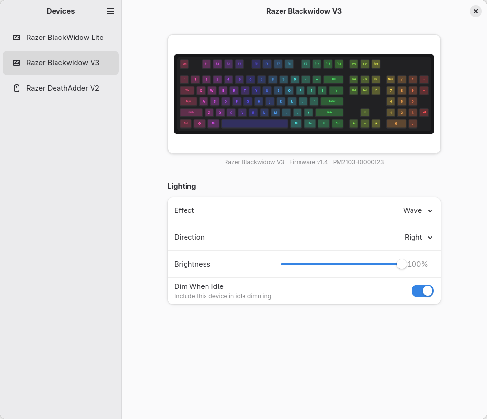

# Synaptix

Controle de iluminação para periféricos Razer no Linux — teclados, mouses, mousepads, notebooks Blade e acessórios — em um app GTK4/libadwaita distribuído como Flatpak.

O Synaptix conversa com cada dispositivo **diretamente por USB HID** (`/dev/hidraw*`). Não precisa do driver de kernel nem do daemon do OpenRazer.



---

## ✨ Funcionalidades

- **Efeitos de hardware**, conforme o suporte de cada dispositivo: estático, respiração (uma cor, duas cores ou aleatória), ciclo de cores, onda, reativo, ondulação, starlight e fogo.
- **Cores por LED**, pintadas clicando direto nas teclas/LEDs da prévia.
- **Brilho** e um efeito de **pulso** com velocidade ajustável (feito pelo app, funciona em qualquer dispositivo com brilho ajustável).
- **Escurecer quando ocioso**: a luz "respira" algumas vezes como aviso, apaga suavemente e volta quando você retorna. Usa o tempo de inatividade da sessão (GNOME ou KDE Plasma), então funciona em X11 e Wayland.
- **Vários dispositivos ao mesmo tempo**, com hot-plug; dispositivos pareados a um receptor sem fio aparecem separadamente.
- **Segundo plano e início com a sessão**: ao fechar a janela o app continua rodando, e na primeira vez que é aberto ele pede permissão (via portal do Flatpak) para iniciar sozinho a cada login.
- As configurações são salvas no app e também na memória do dispositivo.

## 🖱️ Dispositivos compatíveis

- **~180 modelos conhecidos**, da lista de dispositivos do [OpenRGB](https://openrgb.org) (`synaptix/razer/db.py`), mais o **Razer BlackWidow Lite** (teclado com LED branco, dados do [OpenRazer](https://openrazer.github.io)).
- **Modelos fora da lista** são sondados automaticamente: se o firmware responder ao protocolo estendido da Razer e informar seus efeitos, o Synaptix os oferece.
- **Ainda não suportados**: headsets Kraken, o cooler Hanbo e o controlador ARGB, que usam protocolos próprios. Eles aparecem na lista como "Não suportado".

> O BlackWidow Lite tem LED **branco de uma cor só**: o firmware dele só aceita desligado, estático, respiração e brilho. Para ele o app esconde a escolha de cor e as cores por LED.

## 🚀 Instalação

### 1. Instalar o app

Com o arquivo `synaptix.flatpak`:

```bash
flatpak install --user synaptix.flatpak
```

### 2. Dar permissão de acesso aos dispositivos (uma vez)

O Flatpak não pode instalar regras do sistema, então o app mostra este comando na primeira execução, com um botão para copiar:

```bash
echo 'KERNEL=="hidraw*", ATTRS{idVendor}=="1532", TAG+="uaccess"' | sudo tee /etc/udev/rules.d/70-synaptix-razer.rules \
  && sudo udevadm control --reload \
  && sudo udevadm trigger --subsystem-match=hidraw
```

A regra dá ao usuário logado acesso aos dispositivos Razer (`1532` é o fabricante). Não é preciso reiniciar: o Synaptix conecta sozinho em alguns segundos.

> Se o OpenRazer estiver instalado, ele pode continuar instalado. Mas não rode os dois controlando a iluminação ao mesmo tempo.

## 🛠️ Compilar o Flatpak

```bash
flatpak install --user flathub org.flatpak.Builder org.gnome.Sdk//51 org.gnome.Platform//51
flatpak run org.flatpak.Builder --user --force-clean --repo=repo build-dir io.github.joaovmourasouza.Synaptix.yml
flatpak build-bundle repo synaptix.flatpak io.github.joaovmourasouza.Synaptix
```

Para instalar direto do build: `flatpak run org.flatpak.Builder --user --install --force-clean build-dir io.github.joaovmourasouza.Synaptix.yml`.

## 💻 Desenvolvimento

Rodar a partir do código-fonte (precisa de GTK 4, libadwaita e PyGObject no sistema):

```bash
python3 -m synaptix --verbose
```

- **Modo demonstração** (sem hardware; simula um BlackWidow Lite, um BlackWidow V3 e um DeathAdder V2): `SYNAPTIX_DEMO=1 python3 -m synaptix`
- **Testes**: `python3 -m unittest discover -s tests -t .`
- **Atualizar a base de dispositivos** a partir do OpenRGB:
  ```bash
  git clone --depth 1 https://gitlab.com/CalcProgrammer1/OpenRGB.git /tmp/OpenRGB
  python3 tools/gen_razer_db.py /tmp/OpenRGB > synaptix/razer/db.py
  ```
- **Capturas de tela** para o AppStream: `SYNAPTIX_DEMO=1 python3 tools/screenshot.py saida.png [light|dark] [índice do dispositivo] [efeito]`
- **Traduções**: `po/` (pt_BR incluído). Para extrair textos novos:
  `xgettext -L Python --keyword=_ -o po/synaptix.pot synaptix/*.py synaptix/razer/*.py`

### Estrutura

| Arquivo | Função |
|---|---|
| `synaptix/hidraw.py` | Descoberta dos dispositivos e feature reports via `/dev/hidraw*` |
| `synaptix/razer/protocol.py` | Formato dos reports de 90 bytes e comandos |
| `synaptix/razer/driver.py` | Comandos por tipo de matriz (porte do `RazerController` do OpenRGB) |
| `synaptix/razer/catalog.py`, `db.py` | Dados dos dispositivos (`db.py` é gerado) |
| `synaptix/controller.py` | Hot-plug, sondagem de interface, receptores sem fio, fila de comandos |
| `synaptix/lighting.py` | Configurações → comandos; pulso e escurecimento |
| `synaptix/idle.py` | Detecção de inatividade via D-Bus |
| `synaptix/window.py`, `preview.py` | Interface |

## 📦 Publicar no Flathub

1. Renomeie o repositório no GitHub para **`Synaptix`**. O ID `io.github.joaovmourasouza.Synaptix` exige que `github.com/joaovmourasouza/Synaptix` exista (o GitHub redireciona o nome antigo).
2. Faça o push (as capturas em `data/screenshots/` precisam estar acessíveis publicamente) e crie uma tag, por exemplo `v0.1.0`.
3. Faça um fork de [flathub/flathub](https://github.com/flathub/flathub), crie um branch a partir de `new-pr` e adicione o manifesto, trocando a fonte `type: dir` por:
   ```yaml
       sources:
         - type: git
           url: https://github.com/joaovmourasouza/Synaptix.git
           tag: v0.1.0
           commit: <hash do commit da tag>
   ```
4. Abra o pull request para o branch `new-pr`. O uso de `--device=all` é necessário (não existe portal para dispositivos HID); explique isso no PR.

Verifique antes com o linter do Flathub:

```bash
flatpak run --command=flatpak-builder-lint org.flatpak.Builder manifest io.github.joaovmourasouza.Synaptix.yml
flatpak run --command=flatpak-builder-lint org.flatpak.Builder repo repo
```

## 📄 Licença e créditos

GPL-2.0-or-later. Os dados dos dispositivos e a lógica do protocolo vêm do [OpenRGB](https://gitlab.com/CalcProgrammer1/OpenRGB) e do [OpenRazer](https://github.com/openrazer/openrazer), ambos GPL-2.0-or-later.

Synaptix não é afiliado à Razer Inc. "Razer" e nomes de produtos são marcas de seus respectivos donos.
